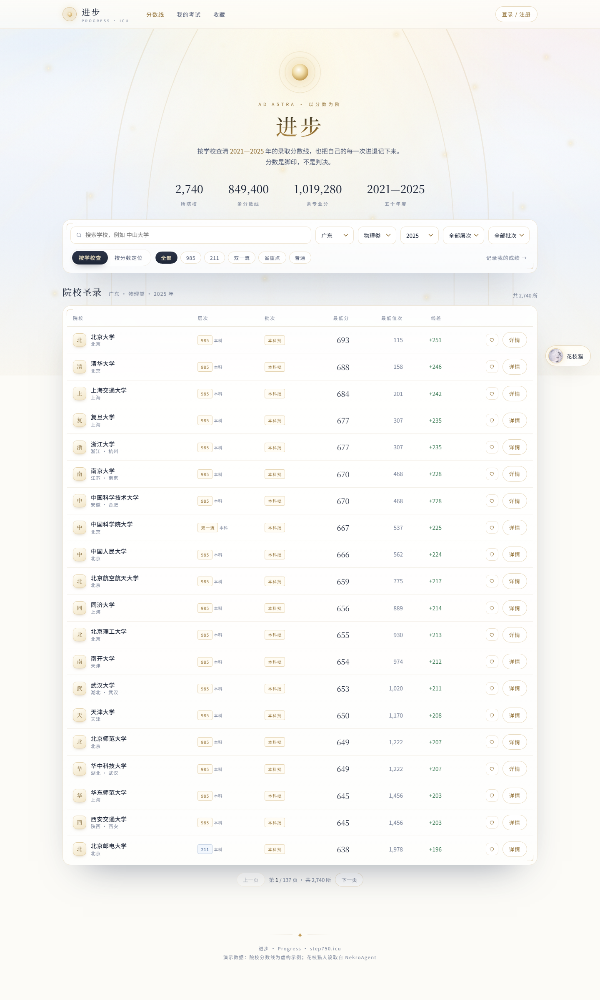

# 进步 · Progress

> 查院校分数线 + 记录自己的每一次考试成绩 + 让 AI 帮你复盘进退步

**线上地址：https://step750.icu**



---

## 这是什么

一个给高中生用的小站，做三件事：

1. **查院校**——2,740 所高校 × 31 个省份 × 2021–2025 年 × 9 个单科，支持「总分 / 单科」双口径查询
2. **记成绩**——把每次考试的分数录进来，自动算总分、较上次进退、各科进退、五年曲线
3. **AI 复盘**——花枝猫（DeepSeek 驱动的猫娘）看你的成绩单，帮你找退步原因、给下一步建议

分数是脚印，不是判决——这是整个站点的出发点。

> ⚠️ **所有分数线均为算法生成的演示数据**，不可用于真实志愿填报。详见下面的「数据说明」。

---

## 功能

### 院校圣录

- 2,740 所院校（教育部全国普通高等学校名单），31 个省级口径
- 9 个单科口径：语文 / 数学 / 英语 / 物理 / 化学 / 生物 / 政治 / 历史 / 地理
- 文理分科：理科 / 文科
- 层次筛选：985 / 211 / 双一流 / 省重点 / 普通
- 每个院校都有：历年总分走势、单科折算分、位次、省控线、线差、专业分数


### 我的考试

- 录入考试名称、日期、各科分数（满分自动匹配）
- 自动算：总分、较上次进退、历史最高、净变化、各科进退
- **总分曲线** + **单科曲线**（点科目切换），一眼看出哪科在掉
- 全部记录可回看、可删除

### 花枝猫 · AI 复盘

- 基于 DeepSeek 模型，人设由站长原创（`persona/huazhimao.md`）
- 会读你的成绩单、收藏的院校，给**数据驱动**的建议，不空谈
- 每人每天 25 条上限（控制成本，也防刷）
- 内置边界规则：不承诺录取、不替你做决定、遇到情绪危机先陪伴

### 分数定位

四个模式自由组合：

| 查什么 | 看什么 |
|---|---|
| 查总分 | 看总分 / 看单科 |
| 查单科 | 看总分 / 看单科 |

输入分数 → 冲（高 1–15 分）/ 稳（±12 分）/ 保（低 13–35 分）三档院校。

### 其他

- 邮箱注册（验证码）+ Turnstile 人机验证（内置算式验证作兜底）
- 收藏心仪院校
- 明暗两种布局自适应，移动端可用

---

## 快速开始

需要 Node 18+（推荐 20/22/24）。

```bash
npm install --ignore-scripts
npx wrangler d1 create jinbu-db          # 记下 database_id，填进 wrangler.toml
node scripts/build-seed.mjs               # 生成 seed/seed.sql
npx wrangler d1 migrations apply DB --local
npx wrangler d1 execute DB --local --file=seed/seed.sql --yes
npx wrangler dev                          # http://127.0.0.1:8787
```

本地调试注册验证码时，在 `.dev.vars` 里加：

```
REQUIRE_EMAIL_CODE=1
DEV_SHOW_CODE=1
```

这样验证码会直接返回在接口响应里，不用真发邮件。

---

## 部署

```bash
node scripts/deploy.mjs
```

脚本会依次：检查登录 → 复用/创建 D1 → 写回 database_id → 应用迁移 → 灌种子 → 部署。

需要的密钥（都在 `.gitignore` 里，不进仓库）：

```bash
npx wrangler secret put MODEL_API_KEY          # DeepSeek，用于花枝猫
npx wrangler secret put RESEND_API_KEY         # 发验证码邮件（免费额度 3000 封/月）
npx wrangler secret put TURNSTILE_SECRET_KEY   # 人机验证
```

`wrangler.toml` 里的变量：

| 变量 | 说明 |
|---|---|
| `MODEL_NAME` | 模型名，默认 `deepseek-flash` |
| `SITE_NAME` / `SITE_DOMAIN` | 站点名 / 域名 |
| `REQUIRE_EMAIL_CODE` | `1` = 注册要邮箱验证码，`0` = 不校验 |
| `TURNSTILE_SITE_KEY` | 人机验证的公开 key（留空则用内置算式验证） |

---

## 用到的工具

| 工具 | 用途 |
|---|---|
| **Cloudflare Workers** | 全站运行时（单文件 API，无框架） |
| **Cloudflare D1** | SQLite，存账号、成绩、收藏、对话 |
| **Workers Assets** | 托管静态页面 |
| **Cloudflare Turnstile** | 免费人机验证，防注册机 |
| **Resend** | 验证码邮件，免费 3,000 封/月 |
| **DeepSeek API** | 花枝猫的模型（`deepseek-flash`） |
| **wrangler** | 部署与本地开发 |
| **原生 JS + 手写 SVG** | 没有前端框架，图表自己画（约 40 行） |
| **Python + Pillow** | 图片裁切、数据集解析 |
| **教育部高校名单** | 2,740 所院校的校名、省份、层次（公开数据集） |

> 没有用 React/Vue/Tailwind，整套前端是 `public/app.js` 一个文件 + `public/app.css`，方便二次修改。

---

## 数据说明（重要）

| 数据 | 来源 | 是否真实 |
|---|---|---|
| 校名 / 省份 / 城市 / 本科-专科 / 主管部门 | 教育部全国普通高等学校名单 | ✅ 真实 |
| 分数线 / 位次 / 省控线 / 专业分 / 单科分 | `lib/synth.mjs` 公式生成 | ❌ **演示数据** |

生成逻辑：`基准分 + 省份偏移 + 文理偏移 + 年度漂移 + 稳定抖动`，同一输入永远输出同一结果。

**它不是任何一年的真实投档线，也不能用于志愿填报。** 页面、「算法说明」页、用户协议里都写明了这一点。

想看完整公式和它的缺陷，站点里有 `/algorithm`（算法说明）页面。

---

## 项目结构

```
worker/index.js          API（认证 / 院校 / 定位 / 考试 / 收藏 / AI）
worker/persona.js        花枝猫人格提示词
lib/synth.mjs            分数生成器（确定性）
lib/geo.mjs              31 省考生规模、省控线、批次规则
lib/data.mjs             早期手工标定的院校数据
data/schools.mjs         2,740 所院校（自动生成）
scripts/build-seed.mjs   生成 D1 种子
scripts/deploy.mjs       一键部署
public/                  前端（app.js / app.css / index.html）
persona/huazhimao.md     花枝猫人设原文
migrations/              D1 表结构
```

---

## 合规说明

- 站内所有分数为算法生成，不抓取、不绕过任何反爬机制
- 不代填志愿、不承诺录取、不售卖数据、不收集身份证/准考证等敏感信息
- 赞赏为自愿支持开发，不构成购买行为
- 花枝猫只做陪伴与复盘，不替学生做志愿决策

详见 `README` 的「合规与数据处理原则」一节与站点 `/terms` 页面。

---

## 说明

代码在此**公开可读**，但**未授予任何使用许可**（All rights reserved）：

- ✅ 可以阅读、学习、参考思路
- ❌ 未经许可，请勿复制、修改后发布，或用于其他项目
- ❌ 请勿搬运站点设计、文案、花枝猫人设

「花枝猫」角色人设（`persona/huazhimao.md` 及其衍生提示词）由站长 maoxian1527 原创并保留全部权利。

站点页面的「关于」页面向访客介绍功能、使用方法与用到的工具；本文件主要面向开发者。
